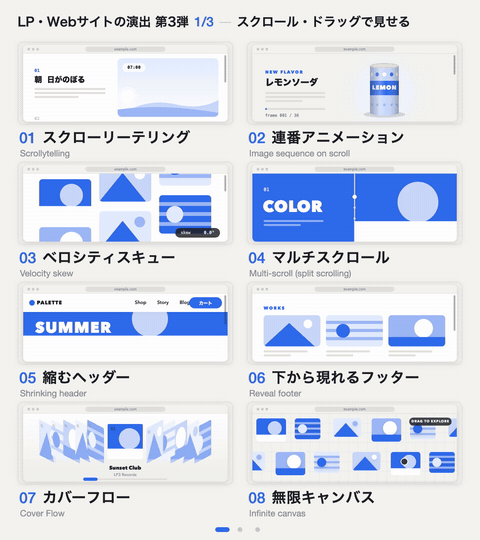

<!-- Generado por tools/build.mjs desde meta.json. Para corregir, edita meta.json, no este archivo. -->

# Efectos de landing pages y sitios web, parte 3

24 nombres · #241–264 · pack `lp3` · Idiomas: [English](README.md) / [日本語](README.ja.md) / [简体中文](README.zh-Hans.md) / [繁體中文](README.zh-Hant.md)

Encuentra el nombre y díselo a tu IA. Si agregas cuánto dura, con qué intensidad y qué se mueve, el resultado se acerca más a lo que imaginabas.

## Efectos con scroll y arrastre

| # | Nombre | Inglés | Qué es | Cómo pedírselo a una IA |
|---|---|---|---|---|
| [#241](https://showheyohtaki.github.io/motion-prompt/#241) | **Scrollytelling** | Scrollytelling | La imagen fija cambia a medida que sigues leyendo | Cuenta el día del servicio con scrollytelling: mientras el texto de la izquierda avanza en tres pasos, cambia la ilustración fija de la derecha de mañana a mediodía y a noche. |
| [#242](https://showheyohtaki.github.io/motion-prompt/#242) | **Secuencia de imágenes con scroll** | Image sequence on scroll | El producto gira a medida que haces scroll | Haz girar la lata nueva con una secuencia de imágenes con scroll: cambia 36 fotogramas según el scroll para que dé exactamente una vuelta al final de la sección. |
| [#243](https://showheyohtaki.github.io/motion-prompt/#243) | **Velocity skew (inclinación por velocidad)** | Velocity skew | Las imágenes se inclinan cuando haces scroll rápido | Agrega velocity skew a la cuadrícula de trabajos: inclina las imágenes hasta 9° según la velocidad del scroll y que vuelvan a quedar rectas cuando el scroll se detenga. |
| [#244](https://showheyohtaki.github.io/motion-prompt/#244) | **Multi-scroll (scroll dividido)** | Multi-scroll (split scrolling) | Dos columnas se desplazan en direcciones opuestas | Haz la presentación del servicio con multi-scroll: títulos a la izquierda y fotos a la derecha; cada scroll sube la columna izquierda y baja la derecha hasta que se alinee el siguiente par. |
| [#245](https://showheyohtaki.github.io/motion-prompt/#245) | **Header que se encoge** | Shrinking header | Al hacer scroll se encoge en una píldora flotante | Haz un header que se encoge: en los primeros 70 px de scroll, que la barra blanca de ancho completo se convierta en una píldora negra delgada y flotante. |
| [#246](https://showheyohtaki.github.io/motion-prompt/#246) | **Footer revelado (reveal footer)** | Reveal footer | La página se levanta y deja ver un footer fijo | Haz un footer revelado: fíjalo al fondo de la pantalla detrás de la página, para que al llegar al final la página se levante y lo deje ver. |
| [#247](https://showheyohtaki.github.io/motion-prompt/#247) | **Cover Flow** | Cover Flow | Las portadas inclinadas giran hacia el centro | Muestra los álbumes nuevos como Cover Flow: una portada de frente y las demás giradas 62° y superpuestas a los lados; cada paso trae la siguiente al frente. Agrega un reflejo en el piso. |
| [#248](https://showheyohtaki.github.io/motion-prompt/#248) | **Lienzo infinito** | Infinite canvas | Arrastra en cualquier dirección, nunca termina | Haz el portafolio como un lienzo infinito: que se pueda arrastrar en cualquier dirección y que las fichas de proyectos se repitan para que nunca haya un borde. |

## Interacciones con el puntero

| # | Nombre | Inglés | Qué es | Cómo pedírselo a una IA |
|---|---|---|---|---|
| [#249](https://showheyohtaki.github.io/motion-prompt/#249) | **Dock con magnificación** | Dock magnification | Los íconos crecen cuanto más cerca está el cursor | Convierte el menú inferior en un dock con magnificación: los íconos cerca del cursor crecen hasta 1.85× y empujan a los vecinos. |
| [#250](https://showheyohtaki.github.io/motion-prompt/#250) | **Tarjeta holográfica** | Holographic card | Al inclinarla la recorre un brillo de arcoíris | Haz la tarjeta de miembro holográfica: que se incline hasta 24° hacia el cursor, con un foil de arcoíris y un reflejo blanco que siguen al cursor por la superficie. |
| [#251](https://showheyohtaki.github.io/motion-prompt/#251) | **Rastro de imágenes (image trail)** | Image trail | Las fotos se acumulan a lo largo del recorrido del cursor | Agrega un rastro de imágenes sobre el título principal: al mover el cursor, deja una foto de un proyecto cada 0.12 s y que se encoja y desaparezca en 0.85 s. |
| [#252](https://showheyohtaki.github.io/motion-prompt/#252) | **Simulación de fluidos** | Fluid simulation | El cursor levanta humo de colores que se arremolina | Pon una simulación de fluidos detrás del hero: humo de cinco colores que surge donde pasa el cursor y se arremolina hasta desaparecer en 1.4 s. |
| [#253](https://showheyohtaki.github.io/motion-prompt/#253) | **Raspa y descubre** | Scratch to reveal | Raspa y aparece lo que hay debajo | Haz el cupón como "raspa y descubre": que la capa se borre solo donde se arrastra y, cuando se haya raspado suficiente, que desaparezca toda y se vea grande "30% OFF". |
| [#254](https://showheyohtaki.github.io/motion-prompt/#254) | **Tarjetas deslizables (swipe)** | Swipe cards | Desliza la tarjeta a la izquierda o la derecha para descartarla | Muestra las recetas sugeridas como tarjetas deslizables: un sello "LIKE" al deslizar a la derecha y "NOPE" a la izquierda, la tarjeta sale inclinada de la pantalla y la siguiente pasa al frente. |
| [#255](https://showheyohtaki.github.io/motion-prompt/#255) | **Pantalla split-flap (de paletas)** | Split-flap display | Las letras giran como en un tablero de salidas | Muestra el destino y la hora del hero como una pantalla split-flap: cada letra se parte y gira de 3 a 5 veces hasta quedar en la siguiente, empezando 0.045 s más tarde por cada letra desde la izquierda. |
| [#256](https://showheyohtaki.github.io/motion-prompt/#256) | **Animación FLIP** | FLIP animation | Al filtrar, las tarjetas se deslizan a sus nuevos lugares | Anima el filtro del portafolio con FLIP: las tarjetas que salen se encogen y desaparecen, y las que quedan se deslizan desde donde estaban a sus nuevos lugares en 0.65 s. |

## Fondos y texturas

| # | Nombre | Inglés | Qué es | Cómo pedírselo a una IA |
|---|---|---|---|---|
| [#257](https://showheyohtaki.github.io/motion-prompt/#257) | **Liquid glass (vidrio líquido)** | Liquid glass | Curva lo que hay detrás como una lente de agua | Haz el menú inferior de liquid glass: dentro de la barra redondeada, amplía el fondo 1.2× y cúrvalo más hacia los bordes hasta 1.7×, con un brillo blanco en el borde superior. |
| [#258](https://showheyohtaki.github.io/motion-prompt/#258) | **Vidrio acanalado (fluted glass)** | Fluted glass | Los colores ondulan a través del vidrio acanalado | Pon vidrio acanalado sobre la mitad derecha del hero: cada estría vertical de 16 px muestra una franja comprimida de los colores y el texto de atrás, con luz en su borde izquierdo y sombra en el derecho. |
| [#259](https://showheyohtaki.github.io/motion-prompt/#259) | **Metal líquido** | Liquid metal | Los reflejos fluyen como metal fundido | Dale al título un aspecto de metal líquido: reflejos plateados, blancos y azules que fluyan y ondulen sin parar como metal fundido. |
| [#260](https://showheyohtaki.github.io/motion-prompt/#260) | **Cáusticas** | Caustics | Una red de luz que tiembla en el fondo del agua | Haz el fondo de la página de la piscina con cáusticas: una red de luz blanquecina que tiembla sin parar sobre un fondo de agua de azul a celeste. |
| [#261](https://showheyohtaki.github.io/motion-prompt/#261) | **Luz moteada (sombras de hojas)** | Dappled light | Sombras de hojas y luz del sol se mecen sobre una pared | Agrega luz moteada detrás de la página del producto: luz del sol inclinada sobre la pared con sombras de hojas desenfocadas que se mecen despacio en un ciclo de 4.7 s. |
| [#262](https://showheyohtaki.github.io/motion-prompt/#262) | **Curvas de nivel (topográfico)** | Topographic contour lines | Las curvas de nivel cambian de forma despacio | Ponle a la página del evento del laboratorio un fondo topográfico: once curvas de nivel en tonos de azul sobre un fondo claro, con el terreno moviéndose despacio. |
| [#263](https://showheyohtaki.github.io/motion-prompt/#263) | **Semitono (halftone)** | Halftone | La imagen se forma con el tamaño de los puntos | Haz la imagen principal en semitono: puntos en una cuadrícula de 8 px con tamaño según el brillo, y dos tramas, una azul y otra azul medio, superpuestas en ángulos distintos. |
| [#264](https://showheyohtaki.github.io/motion-prompt/#264) | **Efecto CRT** | CRT effect | Líneas de escaneo y resplandor le dan aspecto de pantalla CRT | Dale a la página de anuncio del juego un efecto CRT: líneas de escaneo cada 3 px, desfase de rojo y azul, una banda brillante que baja y esquinas más oscuras. |

Cada número abre la muestra en movimiento en la galería. Tiempos, valores de easing y código de referencia de un nombre: `api/v1/en/e/<id>.txt` ([#241](../../api/v1/en/e/241.txt)).

[Todos los packs](../README.md)
