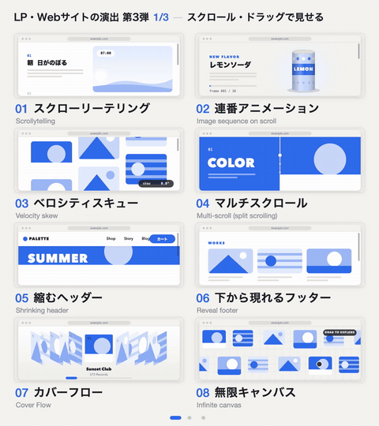

<!-- tools/build.mjs が meta.json から作ったファイルです。直すときは meta.json を編集してください。 -->

# LP・Webサイトの演出 第3弾

24 個の名前 · #241–264 · パック `lp3` · 言語: [English](README.md) / [Español](README.es.md) / [简体中文](README.zh-Hans.md) / [繁體中文](README.zh-Hant.md)

名前を見つけたら、そのままAIに伝えてください。「何秒で」「どのくらい強く」「何が動くか」を添えると、思った通りに近づきます。

## スクロール・ドラッグで見せる

| 番号 | 名前 | 英語名 | ひとこと | AIへの頼み方の例 |
|---|---|---|---|---|
| [#241](https://showheyohtaki.github.io/motion-prompt/#241) | **スクローリーテリング** | Scrollytelling | 読み進めると横の図が切り替わる | サービスの1日の流れをスクローリーテリングで見せて。左の文章が3段進むごとに、右に固定したイラストを朝・昼・夜と切り替えて。 |
| [#242](https://showheyohtaki.github.io/motion-prompt/#242) | **連番アニメーション** | Image sequence on scroll | スクロールに合わせて商品が回る | 新商品の缶を連番アニメーションで回して。36枚の画像をスクロール量に合わせて切り替え、下まで読むとちょうど1回転するように。 |
| [#243](https://showheyohtaki.github.io/motion-prompt/#243) | **ベロシティスキュー** | Velocity skew | 速くスクロールすると傾いて流れる | 作品一覧にベロシティスキューを入れて。スクロールの速さに合わせて画像を最大9°傾け、止まったらまっすぐに戻して。 |
| [#244](https://showheyohtaki.github.io/motion-prompt/#244) | **マルチスクロール** | Multi-scroll (split scrolling) | 左右の列が逆向きに流れる | サービス紹介をマルチスクロールにして。左に見出し、右に写真の2列で、1回のスクロールで左は上へ、右は下へ動いて次の組がそろうように。 |
| [#245](https://showheyohtaki.github.io/motion-prompt/#245) | **縮むヘッダー** | Shrinking header | スクロールで細いピル形にまとまる | ヘッダーを縮むヘッダーにして。70pxスクロールするまでに、幅いっぱいの白い帯から、上に浮く細い黒のピル形に変わるように。 |
| [#246](https://showheyohtaki.github.io/motion-prompt/#246) | **下から現れるフッター** | Reveal footer | 本文がめくれて固定のフッターが出る | フッターを下から現れるフッターにして。フッターは画面の下に固定して本文の下に隠し、最後までスクロールすると本文が上がってフッターが見えるように。 |
| [#247](https://showheyohtaki.github.io/motion-prompt/#247) | **カバーフロー** | Cover Flow | 傾いたジャケットが回り込んで並ぶ | 新作アルバムの一覧をカバーフローにして。正面に1枚、左右は62°傾けて重ね、送ると次の1枚が回り込んで正面に来るように。床に映り込みも付けて。 |
| [#248](https://showheyohtaki.github.io/motion-prompt/#248) | **無限キャンバス** | Infinite canvas | どの方向へもドラッグで見て回れる | 作品の一覧を無限キャンバスにして。上下左右どこへでもドラッグで動かせて、端が来ないように作品のタイルを繰り返し並べて。 |

## 触れると反応する

| 番号 | 名前 | 英語名 | ひとこと | AIへの頼み方の例 |
|---|---|---|---|---|
| [#249](https://showheyohtaki.github.io/motion-prompt/#249) | **ドック風メニュー** | Dock magnification | 近いアイコンほど大きくなる | 下のメニューをドック風メニューにして。カーソルに近いアイコンほど最大1.85倍に大きくして、まわりのアイコンを押し広げて。 |
| [#250](https://showheyohtaki.github.io/motion-prompt/#250) | **ホログラムカード** | Holographic card | 傾けると虹色の光が走る | 会員証をホログラムカードにして。カーソルの向きに最大24°傾け、虹色の箔と白い反射がカーソルを追って表面を流れるように。 |
| [#251](https://showheyohtaki.github.io/motion-prompt/#251) | **イメージトレイル** | Image trail | カーソルの通り道に写真が並ぶ | トップの見出しの上にイメージトレイルを入れて。カーソルを動かすと0.12秒ごとに作品の写真を置き、0.85秒で縮めて消して。 |
| [#252](https://showheyohtaki.github.io/motion-prompt/#252) | **流体シミュレーション** | Fluid simulation | カーソルで色の煙が渦を巻く | トップの背景に流体シミュレーションを入れて。カーソルが通った所から5色の煙が湧いて、渦を巻きながら1.4秒で薄れて消えるように。 |
| [#253](https://showheyohtaki.github.io/motion-prompt/#253) | **スクラッチカード** | Scratch to reveal | こすると下の絵柄が出てくる | クーポンをスクラッチカードにして。表面の膜をドラッグでこすった所だけ消し、ある程度削ったら膜を全部消して「30% OFF」を大きく見せて。 |
| [#254](https://showheyohtaki.github.io/motion-prompt/#254) | **スワイプカード** | Swipe cards | 左右に払ってカードを送る | おすすめのレシピをスワイプカードにして。右に払ったら「LIKE」、左なら「NOPE」の印を出して、傾けながら画面の外へ飛ばし、下のカードを前に出して。 |
| [#255](https://showheyohtaki.github.io/motion-prompt/#255) | **パタパタ表示** | Split-flap display | 文字の板がめくれて替わる | トップの行き先と時刻をパタパタ表示にして。1文字ずつの板が上下に割れて3〜5回めくれ、左から0.045秒ずつずれて次の文字に止まるように。 |
| [#256](https://showheyohtaki.github.io/motion-prompt/#256) | **FLIPアニメーション** | FLIP animation | 絞り込むとカードが滑って並び直す | 作品一覧の絞り込みを FLIP アニメーションにして。外れたカードは縮んで消し、残ったカードは今の場所から新しい場所へ0.65秒で滑らせて。 |

## 背景・質感

| 番号 | 名前 | 英語名 | ひとこと | AIへの頼み方の例 |
|---|---|---|---|---|
| [#257](https://showheyohtaki.github.io/motion-prompt/#257) | **リキッドグラス** | Liquid glass | 水のレンズのように背景を曲げる | 下のメニューをリキッドグラスにして。丸いバーの中で背景を1.2倍に、ふちほど1.7倍まで強く曲げて、上のふちに白い光を入れて。 |
| [#258](https://showheyohtaki.github.io/motion-prompt/#258) | **フルーテッドガラス** | Fluted glass | 縦溝のガラス越しに色が揺れる | ファーストビューの右半分にフルーテッドガラスを重ねて。幅16pxの縦の溝ごとに、うしろの色と文字を細く縮めて映し、溝の左に光、右に影を入れて。 |
| [#259](https://showheyohtaki.github.io/motion-prompt/#259) | **リキッドメタル** | Liquid metal | 溶けた金属のように光が流れる | 見出しの文字をリキッドメタルにして。銀と白と青の映り込みが、溶けた金属のようにうねりながら流れ続けるように。 |
| [#260](https://showheyohtaki.github.io/motion-prompt/#260) | **コースティクス** | Caustics | 水の底でゆらめく光の網目 | プールのページの背景をコースティクスにして。青から水色の水の底に、白い光の網目がゆらめき続けるように。 |
| [#261](https://showheyohtaki.github.io/motion-prompt/#261) | **木漏れ日** | Dappled light | 葉の影と光が壁でゆれる | 商品ページの背景に木漏れ日を入れて。壁に斜めの日差しを当て、ぼけた葉の影を4.7秒周期でゆっくり揺らして。 |
| [#262](https://showheyohtaki.github.io/motion-prompt/#262) | **トポグラフィック** | Topographic contour lines | 等高線がゆっくり形を変える | 研究所のイベントページの背景をトポグラフィックにして。明るい地に青の濃淡の等高線を11本、地形ごとゆっくりうねらせて。 |
| [#263](https://showheyohtaki.github.io/motion-prompt/#263) | **ハーフトーン** | Halftone | 網点の大きさで絵が浮かぶ | キービジュアルをハーフトーンにして。8px 間隔の網点を、明るさに合わせた大きさで描き、濃い青と中間の青の2色を別の角度で重ねて。 |
| [#264](https://showheyohtaki.github.io/motion-prompt/#264) | **CRTエフェクト** | CRT effect | 走査線とにじみでブラウン管風に | ゲームの告知ページを CRT エフェクトにして。3px おきの走査線、赤と青の色ずれ、上から下へ流れる明るい帯、四隅を暗くして。 |

番号を押すと、ギャラリーの動く見本が開きます。1つの名前の秒数・イージングの数値・参考コード: `api/v1/ja/e/<id>.txt` ([#241](../../api/v1/ja/e/241.txt)).

[パックの一覧](../README.md)
