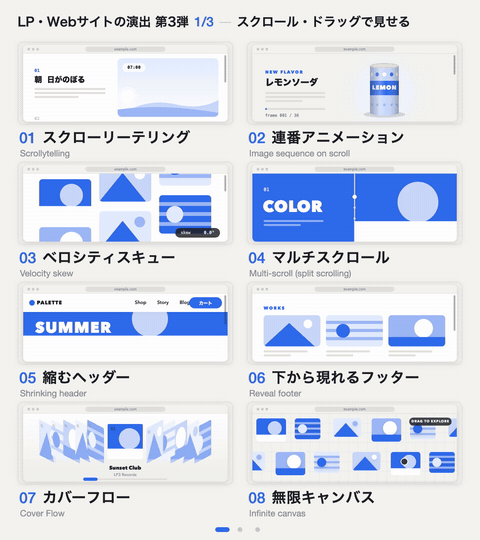

<!-- Generated by tools/build.mjs from meta.json. Edit meta.json, not this file. -->

# Landing page & web effects, part 3

24 names · #241–264 · pack `lp3` · Languages: [Español](README.es.md) / [日本語](README.ja.md) / [简体中文](README.zh-Hans.md) / [繁體中文](README.zh-Hant.md)

Find the name, then say it to your AI. Add how long, how strong and what moves, and the result gets closer to what you had in mind.

## Scroll & drag effects

| # | Name | What it is | How to ask an AI |
|---|---|---|---|
| [#241](https://showheyohtaki.github.io/motion-prompt/#241) | **Scrollytelling** | The pinned picture changes as you read on | Tell the service's day as scrollytelling: as the text on the left moves through three steps, switch the pinned illustration on the right from morning to noon to night. |
| [#242](https://showheyohtaki.github.io/motion-prompt/#242) | **Image sequence on scroll** | The product turns as you scroll | Spin the new can with an image sequence on scroll: swap 36 frames by scroll position so it makes exactly one turn by the end of the section. |
| [#243](https://showheyohtaki.github.io/motion-prompt/#243) | **Velocity skew** | Images lean while you scroll fast | Add velocity skew to the work grid: tilt the images up to 9° with the scroll speed and let them settle back straight when the scroll stops. |
| [#244](https://showheyohtaki.github.io/motion-prompt/#244) | **Multi-scroll (split scrolling)** | Two columns scroll in opposite directions | Make the service intro a multi-scroll: headings on the left, photos on the right, and each scroll moves the left column up and the right column down until the next pair lines up. |
| [#245](https://showheyohtaki.github.io/motion-prompt/#245) | **Shrinking header** | On scroll it shrinks into a slim floating pill | Make it a shrinking header: within the first 70 px of scroll, turn the full-width white bar into a slim floating black pill. |
| [#246](https://showheyohtaki.github.io/motion-prompt/#246) | **Reveal footer** | The page lifts away to uncover a fixed footer | Make the footer a reveal footer: fix it to the bottom of the viewport behind the page, so that scrolling to the end lifts the page off it. |
| [#247](https://showheyohtaki.github.io/motion-prompt/#247) | **Cover Flow** | Angled covers swing round into the center | Show the new albums as a Cover Flow: one cover facing front, the rest turned 62° and overlapping on both sides; each step swings the next one round to the front. Add a reflection on the floor. |
| [#248](https://showheyohtaki.github.io/motion-prompt/#248) | **Infinite canvas** | Drag in any direction, it never ends | Make the portfolio an infinite canvas: drag it in any direction, with the project tiles repeating so there is never an edge. |

## Pointer interactions

| # | Name | What it is | How to ask an AI |
|---|---|---|---|
| [#249](https://showheyohtaki.github.io/motion-prompt/#249) | **Dock magnification** | Icons grow the closer the cursor gets | Turn the bottom menu into dock magnification: icons near the cursor grow up to 1.85× and push their neighbors aside. |
| [#250](https://showheyohtaki.github.io/motion-prompt/#250) | **Holographic card** | Tilt it and a rainbow sheen runs across | Make the member card a holographic card: tilt it up to 24° toward the cursor, with a rainbow foil and a white glare that follow the cursor across the surface. |
| [#251](https://showheyohtaki.github.io/motion-prompt/#251) | **Image trail** | Photos pile up along the cursor's path | Add an image trail over the hero heading: as the cursor moves, drop a project photo every 0.12 s and shrink it away over 0.85 s. |
| [#252](https://showheyohtaki.github.io/motion-prompt/#252) | **Fluid simulation** | The cursor stirs up swirling colored smoke | Put a fluid simulation behind the hero: colored smoke in five colors rises where the cursor passes and swirls away over 1.4 s. |
| [#253](https://showheyohtaki.github.io/motion-prompt/#253) | **Scratch to reveal** | Rub it and what is underneath appears | Make the coupon a scratch to reveal card: wipe the coating only where it is dragged over, and once enough is gone clear it all and show "30% OFF" big. |
| [#254](https://showheyohtaki.github.io/motion-prompt/#254) | **Swipe cards** | Flick a card left or right to send it away | Show the suggested recipes as swipe cards: a "LIKE" stamp when flicked right and "NOPE" when flicked left, the card tilting off screen while the next one moves up. |
| [#255](https://showheyohtaki.github.io/motion-prompt/#255) | **Split-flap display** | Letters flip over like a departure board | Show the destination and time in the hero as a split-flap display: each letter tile splits and flips 3 to 5 times and lands on the next letter, starting 0.045 s later per letter from the left. |
| [#256](https://showheyohtaki.github.io/motion-prompt/#256) | **FLIP animation** | Filter, and the cards slide into their new places | Animate the portfolio filter with FLIP: cards that drop out shrink away, and the remaining cards slide from where they were to their new places in 0.65 s. |

## Backgrounds & textures

| # | Name | What it is | How to ask an AI |
|---|---|---|---|
| [#257](https://showheyohtaki.github.io/motion-prompt/#257) | **Liquid glass** | Bends what is behind it like a lens of water | Make the bottom menu liquid glass: inside the rounded bar, magnify the background 1.2× and bend it harder toward the edges up to 1.7×, with a white highlight along the top edge. |
| [#258](https://showheyohtaki.github.io/motion-prompt/#258) | **Fluted glass** | Colors ripple through ribbed glass | Lay fluted glass over the right half of the hero: each 16 px vertical rib shows a squeezed slice of the colors and text behind it, with light on its left edge and shade on its right. |
| [#259](https://showheyohtaki.github.io/motion-prompt/#259) | **Liquid metal** | Reflections flow like molten metal | Give the heading a liquid metal look: silver, white and blue reflections that keep flowing and rippling like molten metal. |
| [#260](https://showheyohtaki.github.io/motion-prompt/#260) | **Caustics** | A shimmering net of light on the bottom of water | Make the pool page background caustics: a whitish net of light that keeps shimmering on a blue to light-blue water floor. |
| [#261](https://showheyohtaki.github.io/motion-prompt/#261) | **Dappled light** | Leaf shadows and sunlight sway on a wall | Add dappled light behind the product page: slanted sunlight on the wall with blurred leaf shadows swaying slowly on a 4.7 s cycle. |
| [#262](https://showheyohtaki.github.io/motion-prompt/#262) | **Topographic contour lines** | Contour lines slowly change shape | Give the research lab's event page a topographic background: eleven contour lines in shades of blue on a light ground, the terrain slowly shifting. |
| [#263](https://showheyohtaki.github.io/motion-prompt/#263) | **Halftone** | The picture is drawn by the size of dots | Render the key visual as halftone: dots on an 8 px grid sized by brightness, with blue and mid-blue screens laid at different angles. |
| [#264](https://showheyohtaki.github.io/motion-prompt/#264) | **CRT effect** | Scanlines and glow make it look like an old CRT | Give the game announcement page a CRT effect: scanlines every 3 px, a red and blue color offset, a bright band rolling down and darker corners. |

Each number opens the moving sample in the gallery. Timings, easing values and reference code for one name: `api/v1/en/e/<id>.txt` ([#241](../../api/v1/en/e/241.txt)).

[All packs](../README.md)
