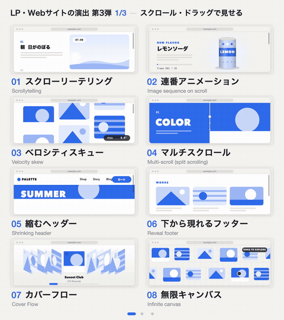

<!-- 由 tools/build.mjs 根据 meta.json 生成。请编辑 meta.json，不要直接修改本文件。 -->

# 落地页与网页效果（第 3 弹）

24 个术语 · #241–264 · 分类 `lp3` · 语言: [English](README.md) / [Español](README.es.md) / [日本語](README.ja.md) / [繁體中文](README.zh-Hant.md)

找到名称后直接告诉 AI。补充时长、幅度和运动对象，可以更接近你想要的效果。

## 滚动与拖拽效果

| 编号 | 名称 | 英文名 | 含义 | 向 AI 提出需求的示例 |
|---|---|---|---|---|
| [#241](https://showheyohtaki.github.io/motion-prompt/#241) | **滚动叙事** | Scrollytelling | 往下阅读时，固定在旁边的图随之切换 | 用滚动叙事展示服务的一天：左侧文字每推进一段，右侧固定的插画就依次切换为早上、中午、夜晚。 |
| [#242](https://showheyohtaki.github.io/motion-prompt/#242) | **滚动序列帧动画** | Image sequence on scroll | 产品随着滚动旋转 | 用滚动序列帧动画让新品易拉罐旋转：按滚动量切换36张图片，滚到区块底部时正好转一圈。 |
| [#243](https://showheyohtaki.github.io/motion-prompt/#243) | **滚动速度倾斜** | Velocity skew | 快速滚动时图片倾斜着流过 | 给作品列表加上滚动速度倾斜：图片按滚动速度最多倾斜9°，停止滚动后回正。 |
| [#244](https://showheyohtaki.github.io/motion-prompt/#244) | **分屏反向滚动** | Multi-scroll (split scrolling) | 左右两栏朝相反方向滚动 | 把服务介绍做成分屏反向滚动：左栏标题、右栏照片，每滚动一次左栏向上、右栏向下，直到下一组对齐。 |
| [#245](https://showheyohtaki.github.io/motion-prompt/#245) | **收缩式页眉** | Shrinking header | 滚动时缩成细长的悬浮胶囊形 | 把页眉做成收缩式页眉：滚动前70px内，从通栏白色横条变成悬浮的细长黑色胶囊。 |
| [#246](https://showheyohtaki.github.io/motion-prompt/#246) | **揭示式页脚** | Reveal footer | 正文上移，露出固定在底部的页脚 | 把页脚做成揭示式页脚：页脚固定在视口底部并藏在正文后面，滚到最后时正文上移，露出页脚。 |
| [#247](https://showheyohtaki.github.io/motion-prompt/#247) | **封面流（Cover Flow）** | Cover Flow | 倾斜的封面旋转到正中 | 用封面流展示新专辑：正中一张朝前，两侧的封面转62°叠在一起，每翻一步下一张就转到正面。地面加上倒影。 |
| [#248](https://showheyohtaki.github.io/motion-prompt/#248) | **无限画布** | Infinite canvas | 向任意方向拖动浏览，没有尽头 | 把作品集做成无限画布：可以向上下左右任意方向拖动，作品卡片重复排列，永远没有边界。 |

## 指针交互

| 编号 | 名称 | 英文名 | 含义 | 向 AI 提出需求的示例 |
|---|---|---|---|---|
| [#249](https://showheyohtaki.github.io/motion-prompt/#249) | **Dock 放大效果** | Dock magnification | 离光标越近的图标越大 | 把底部菜单做成 Dock 放大效果：靠近光标的图标最多放大到1.85倍，并把旁边的图标推开。 |
| [#250](https://showheyohtaki.github.io/motion-prompt/#250) | **全息卡片** | Holographic card | 倾斜时彩虹光泽在表面流动 | 把会员卡做成全息卡片：朝光标方向最多倾斜24°，彩虹箔和白色反光随光标在表面流动。 |
| [#251](https://showheyohtaki.github.io/motion-prompt/#251) | **图片拖尾** | Image trail | 光标经过的地方排出一串照片 | 在首屏标题上加入图片拖尾：移动光标时每0.12秒放下一张作品照片，0.85秒内缩小消失。 |
| [#252](https://showheyohtaki.github.io/motion-prompt/#252) | **流体模拟** | Fluid simulation | 光标搅起旋转的彩色烟雾 | 在首屏背景加入流体模拟：光标经过的地方冒出五种颜色的烟雾，旋转着在1.4秒内淡出。 |
| [#253](https://showheyohtaki.github.io/motion-prompt/#253) | **刮刮卡** | Scratch to reveal | 刮开后露出下面的图案 | 把优惠券做成刮刮卡：拖动刮过的地方才去掉表层，刮到一定程度后整层消失，大大地显示“30% OFF”。 |
| [#254](https://showheyohtaki.github.io/motion-prompt/#254) | **滑动卡片** | Swipe cards | 向左或向右甩出卡片 | 把推荐食谱做成滑动卡片：向右甩出现“LIKE”印章，向左甩出现“NOPE”，卡片倾斜着飞出画面，下面的卡片移到最前。 |
| [#255](https://showheyohtaki.github.io/motion-prompt/#255) | **翻牌显示（Split-flap）** | Split-flap display | 像车站时刻牌一样逐字翻转更换 | 把首屏的目的地和时间做成翻牌显示：每个字的牌上下分开翻转3到5次后停在下一个字，从左边起每个字晚0.045秒开始。 |
| [#256](https://showheyohtaki.github.io/motion-prompt/#256) | **FLIP 动画** | FLIP animation | 筛选后卡片滑动到新的位置重新排列 | 用 FLIP 动画做作品筛选：被筛掉的卡片缩小消失，留下的卡片在0.65秒内从原位置滑到新位置。 |

## 背景与质感

| 编号 | 名称 | 英文名 | 含义 | 向 AI 提出需求的示例 |
|---|---|---|---|---|
| [#257](https://showheyohtaki.github.io/motion-prompt/#257) | **液态玻璃** | Liquid glass | 像水做的透镜一样弯曲背后的画面 | 把底部菜单做成液态玻璃：圆角条内把背景放大1.2倍，越靠边缘弯曲越强，最多1.7倍，上边缘加白色高光。 |
| [#258](https://showheyohtaki.github.io/motion-prompt/#258) | **长虹玻璃效果** | Fluted glass | 透过竖纹玻璃看到晃动的色彩 | 在首屏右半边叠一层长虹玻璃：每条16px宽的竖纹里，把后面的颜色和文字压窄映出，竖纹左侧加高光、右侧加阴影。 |
| [#259](https://showheyohtaki.github.io/motion-prompt/#259) | **液态金属** | Liquid metal | 反光像熔化的金属一样流动 | 把标题文字做成液态金属：银色、白色和蓝色的反光像熔化的金属一样不断起伏流动。 |
| [#260](https://showheyohtaki.github.io/motion-prompt/#260) | **焦散** | Caustics | 水底摇曳的光网 | 把泳池页面的背景做成焦散：在蓝色到浅蓝色的水底，泛白的光网不停摇曳。 |
| [#261](https://showheyohtaki.github.io/motion-prompt/#261) | **树影光斑** | Dappled light | 叶影和阳光在墙上摇曳 | 在商品页背景加入树影光斑：墙上斜照着阳光，模糊的叶影以4.7秒为周期缓缓摇曳。 |
| [#262](https://showheyohtaki.github.io/motion-prompt/#262) | **等高线纹理** | Topographic contour lines | 等高线缓缓变换形状 | 把研究所活动页面的背景做成等高线纹理：浅色底上画11条深浅不同的蓝色等高线，地形缓缓起伏变化。 |
| [#263](https://showheyohtaki.github.io/motion-prompt/#263) | **半色调** | Halftone | 用网点的大小呈现画面 | 把主视觉做成半色调：8px间距的网点按亮度决定大小，深蓝和中蓝两层网点以不同角度叠加。 |
| [#264](https://showheyohtaki.github.io/motion-prompt/#264) | **CRT 显像管效果** | CRT effect | 用扫描线和光晕做出老式显像管的感觉 | 把游戏发布页面做成CRT显像管效果：每3px一条扫描线，红蓝色差，一条亮带从上往下滚动，四角变暗。 |

点击编号可打开动态示例。单个术语的时间、缓动数值与参考代码位于： `api/v1/en/e/<id>.txt` ([#241](../../api/v1/en/e/241.txt)).

[全部分类](../README.md)
