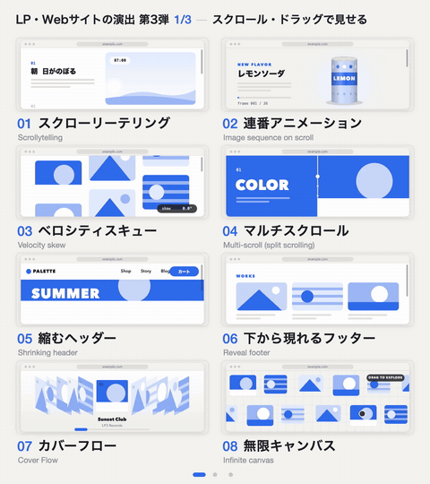

<!-- 這個檔案由 tools/build.mjs 根據 meta.json 產生。要修改請編輯 meta.json，不要改這個檔案。 -->

# Landing Page 與網站效果 第 3 彈

24 個名稱 · #241–264 · 包 `lp3` · 語言: [English](README.md) / [Español](README.es.md) / [日本語](README.ja.md) / [简体中文](README.zh-Hans.md)

找到名稱後，直接告訴 AI。再加上「幾秒」「多強」「什麼在動」，結果會更接近你想要的。

## 捲動與拖曳效果

| 編號 | 名稱 | 英文名稱 | 一句話說明 | 對 AI 的說法範例 |
|---|---|---|---|---|
| [#241](https://showheyohtaki.github.io/motion-prompt/#241) | **捲動敘事** | Scrollytelling | 往下讀時，固定在旁邊的圖跟著切換 | 服務的一天請用捲動敘事呈現：左邊的文字每往下走一段，右邊固定的插圖就依序切換成早上、中午、晚上。 |
| [#242](https://showheyohtaki.github.io/motion-prompt/#242) | **捲動序列幀動畫** | Image sequence on scroll | 商品跟著捲動旋轉 | 新商品的罐子請用捲動序列幀動畫轉動：依捲動量切換36張圖片，捲到區塊最下面時剛好轉一圈。 |
| [#243](https://showheyohtaki.github.io/motion-prompt/#243) | **捲動速度傾斜** | Velocity skew | 捲得越快，圖片越傾斜 | 作品列表請加上捲動速度傾斜：圖片依捲動速度最多傾斜9°，停止捲動後再回正。 |
| [#244](https://showheyohtaki.github.io/motion-prompt/#244) | **分割畫面反向捲動** | Multi-scroll (split scrolling) | 左右兩欄往相反方向捲動 | 服務介紹請做成分割畫面反向捲動：左欄標題、右欄照片，每捲一次左欄往上、右欄往下，直到下一組對齊。 |
| [#245](https://showheyohtaki.github.io/motion-prompt/#245) | **縮小式頁首** | Shrinking header | 捲動時縮成細長的懸浮膠囊形 | 頁首請做成縮小式頁首：捲動前70px內，從整排白色橫條變成浮在上方的細長黑色膠囊。 |
| [#246](https://showheyohtaki.github.io/motion-prompt/#246) | **揭露式頁尾** | Reveal footer | 內文往上移開，露出固定在底部的頁尾 | 頁尾請做成揭露式頁尾：頁尾固定在畫面底部、藏在內文後面，捲到最後時內文往上移開，露出頁尾。 |
| [#247](https://showheyohtaki.github.io/motion-prompt/#247) | **Cover Flow 封面流** | Cover Flow | 傾斜的封面轉到正中央 | 新專輯請用 Cover Flow 封面流呈現：正中一張朝前，兩側封面轉62°疊在一起，每翻一步下一張就轉到正面。地面加上倒影。 |
| [#248](https://showheyohtaki.github.io/motion-prompt/#248) | **無限畫布** | Infinite canvas | 往任何方向拖曳瀏覽，沒有盡頭 | 作品集請做成無限畫布：可以往上下左右任意方向拖曳，作品卡片重複排列，永遠沒有邊界。 |

## 游標互動效果

| 編號 | 名稱 | 英文名稱 | 一句話說明 | 對 AI 的說法範例 |
|---|---|---|---|---|
| [#249](https://showheyohtaki.github.io/motion-prompt/#249) | **Dock 放大效果** | Dock magnification | 離游標越近的圖示越大 | 底部選單請做成 Dock 放大效果：靠近游標的圖示最多放大到1.85倍，並把旁邊的圖示推開。 |
| [#250](https://showheyohtaki.github.io/motion-prompt/#250) | **全像卡片** | Holographic card | 傾斜時彩虹光澤在表面流動 | 會員卡請做成全像卡片：朝游標方向最多傾斜24°，彩虹箔和白色反光跟著游標在表面流動。 |
| [#251](https://showheyohtaki.github.io/motion-prompt/#251) | **圖片拖尾** | Image trail | 游標經過的地方排出一串照片 | 首頁標題上請加入圖片拖尾：移動游標時每0.12秒放下一張作品照片，0.85秒內縮小消失。 |
| [#252](https://showheyohtaki.github.io/motion-prompt/#252) | **流體模擬** | Fluid simulation | 游標攪起旋轉的彩色煙霧 | 首頁背景請加入流體模擬：游標經過的地方冒出五種顏色的煙霧，旋轉著在1.4秒內淡出。 |
| [#253](https://showheyohtaki.github.io/motion-prompt/#253) | **刮刮卡** | Scratch to reveal | 刮開後露出下面的圖案 | 優惠券請做成刮刮卡：拖曳刮過的地方才去掉表層，刮到一定程度後整層消失，大大顯示「30% OFF」。 |
| [#254](https://showheyohtaki.github.io/motion-prompt/#254) | **滑動卡片** | Swipe cards | 往左或往右甩出卡片 | 推薦食譜請做成滑動卡片：往右甩出現「LIKE」印章、往左甩出現「NOPE」，卡片傾斜著飛出畫面，下面的卡片移到最前面。 |
| [#255](https://showheyohtaki.github.io/motion-prompt/#255) | **翻牌顯示（Split-flap）** | Split-flap display | 像車站時刻牌一樣逐字翻轉更換 | 首頁的目的地和時間請做成翻牌顯示：每個字的牌上下分開翻轉3到5次後停在下一個字，從左邊起每個字晚0.045秒開始。 |
| [#256](https://showheyohtaki.github.io/motion-prompt/#256) | **FLIP 動畫** | FLIP animation | 篩選後卡片滑到新的位置重新排列 | 作品篩選請用 FLIP 動畫：被篩掉的卡片縮小消失，留下的卡片在0.65秒內從原位置滑到新位置。 |

## 背景與質感

| 編號 | 名稱 | 英文名稱 | 一句話說明 | 對 AI 的說法範例 |
|---|---|---|---|---|
| [#257](https://showheyohtaki.github.io/motion-prompt/#257) | **液態玻璃** | Liquid glass | 像水做的透鏡一樣彎曲背後的畫面 | 底部選單請做成液態玻璃：圓角條內把背景放大1.2倍，越靠邊緣彎得越強，最多1.7倍，上緣加上白色高光。 |
| [#258](https://showheyohtaki.github.io/motion-prompt/#258) | **長虹玻璃效果** | Fluted glass | 透過直紋玻璃看到晃動的色彩 | 首頁右半邊請疊上長虹玻璃：每條16px寬的直紋裡，把後面的顏色和文字壓窄映出，直紋左側加高光、右側加陰影。 |
| [#259](https://showheyohtaki.github.io/motion-prompt/#259) | **液態金屬** | Liquid metal | 反光像熔化的金屬一樣流動 | 標題文字請做成液態金屬：銀色、白色和藍色的反光像熔化的金屬一樣不斷起伏流動。 |
| [#260](https://showheyohtaki.github.io/motion-prompt/#260) | **焦散** | Caustics | 水底搖曳的光網 | 泳池頁面的背景請做成焦散：在藍色到淺藍色的水底，泛白的光網不停搖曳。 |
| [#261](https://showheyohtaki.github.io/motion-prompt/#261) | **樹影光斑** | Dappled light | 葉影和陽光在牆上搖曳 | 商品頁背景請加入樹影光斑：牆上斜照著陽光，模糊的葉影以4.7秒為週期慢慢搖曳。 |
| [#262](https://showheyohtaki.github.io/motion-prompt/#262) | **等高線紋理** | Topographic contour lines | 等高線慢慢變換形狀 | 研究所活動頁面的背景請做成等高線紋理：淺色底上畫11條深淺不同的藍色等高線，地形慢慢起伏變化。 |
| [#263](https://showheyohtaki.github.io/motion-prompt/#263) | **半色調** | Halftone | 用網點的大小呈現畫面 | 主視覺請做成半色調：8px間距的網點依亮度決定大小，深藍和中藍兩層網點以不同角度疊加。 |
| [#264](https://showheyohtaki.github.io/motion-prompt/#264) | **CRT 映像管效果** | CRT effect | 用掃描線和光暈做出老式映像管的感覺 | 遊戲公告頁面請做成CRT映像管效果：每3px一條掃描線，紅藍色差，一條亮帶由上往下捲動，四角變暗。 |

點編號會在圖庫打開會動的範例。單一名稱的秒數、緩動數值和參考程式碼： `api/v1/en/e/<id>.txt` ([#241](../../api/v1/en/e/241.txt)).

[所有包](../README.md)
